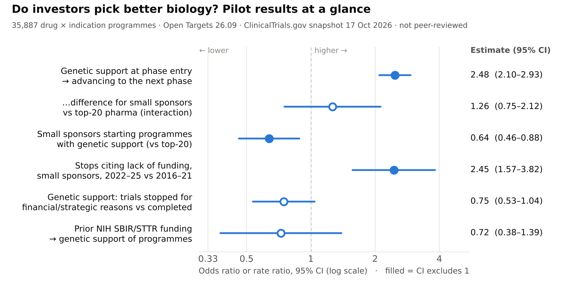

# Do investors pick better biology?
### Human genetic support × sponsor type × clinical success

[](https://github.com/lappunovmark/vc-genetics-pilot/actions/workflows/checks.yml)

[](LICENSE)


Independent research project by **Mark Lapunov** (MSc Bioscience Innovation and Enterprise, University College London).
Pilot code and results for a working paper on ex-ante human genetic support, sponsor type and clinical development
outcomes, which is also the basis of my MSc dissertation.

[Results at a glance](#results-at-a-glance) · [Pipeline](#pipeline) · [Validation](#validation-done) ·
[Pilot results](#pilot-results-open-targets-2609-clinicaltrialsgov-snapshot-17-oct-2026) · [Roadmap](#roadmap) ·
[Methods](docs/methods.md) · [Data dictionary](docs/data_dictionary.md) · [Citation](#citation)

**Questions**
1. Do different sponsors (small and mid-size industry sponsors vs. top-20 pharma) start programmes on drug targets with
   stronger human genetic support?
2. Does that explain differences in how often their programmes advance from one clinical phase to the next?
3. How did the 2022 biotech funding downturn change why clinical trials stop, and did money-driven stops hit
   genetically better-supported programmes?

**Status.** Pilot results, not peer-reviewed. Sponsor tiers stand in for venture backing until venture rounds from
SEC EDGAR Form D filings are linked (next step).

## Results at a glance


* **Genetic support predicts progress for every sponsor.** Programmes on targets with human genetic support at phase
  entry have about 2.5 times the odds of advancing a phase, with no significant difference between small sponsors and
  top-20 pharma.
* **Small sponsors use the signal less.** They start fewer programmes with genetic support (adjusted OR 0.64).
* **Funding-driven stops rose after 2022.** Trial stops citing lack of funding rose 2.45-fold among small sponsors;
  trials stopped for financial or strategic reasons carried no more genetic support than completed ones.

Figure: `python pilot/figure_glance.py results figures/results_glance.png` (reads the numbers from `results/`).

## Pipeline
| Step | Script | Source (licence) |
|---|---|---|
| Open Targets clinical reports, evidence, targets, diseases, molecules | `pilot/fetch_opentargets.py` | Open Targets Platform ≥ 26.03 (CC0) |
| All interventional studies (sponsor, phase, dates, status, why_stopped) | `pilot/fetch_ctgov.py all` | ClinicalTrials.gov API v2 (public domain) |
| Genetic-support labels (Minikel et al. 2024 definition) | `pilot/gensup.py` | `ericminikel/genetic_support` @ b84cf05 (CC BY 4.0) |
| Programme panel, H1 selection, phase transitions, logits | `pilot/build_panel26.py` | — |
| Robustness: adjusted H1, strict / similar-indication advancement, no-OMIM, benchmark | `pilot/robust26.py` | — |
| Ex-ante support from Open Targets evidence dated by Falaguera et al. | `pilot/gs_ot_dated.py` | Zenodo 15922783 (OT 25.03) |
| RQ2: stop reasons and rates around the 2022 funding downturn | `pilot/rq2_stops.py`, `pilot/rq2_rr.py`, `pilot/stopreasons.py` | — |
| H4, second part: genetic support of trials stopped for money vs completed | `pilot/h4_biology.py` | — |
| NIH SBIR/STTR awards, sponsor linkage (hand-review decisions in `pilot/sbir_decisions.csv`), models | `pilot/fetch_reporter_sbir.py`, `pilot/sbir_link.py`, `pilot/sbir_models.py` | NIH RePORTER API v2 (public) |
| Sponsor typing (acquisition- and spin-off-dated top-20) | `pilot/sponsors.py` | — |
| Results-at-a-glance figure | `pilot/figure_glance.py` | — |

Run locally with `make all` (downloads, rebuilds `results/`, redraws the figure and runs the checks), or step by step:
```
python pilot/fetch_opentargets.py data/ot
python pilot/fetch_ctgov.py all data/ctgov_all.csv
git clone https://github.com/ericminikel/genetic_support /tmp/genetic_support   # then checkout b84cf05
python pilot/build_panel26.py data/ot /tmp/genetic_support/data results
python pilot/robust26.py results
python pilot/gs_ot_dated.py results data/ot data/falaguera/evidence_dated /tmp/genetic_support/data
python pilot/rq2_stops.py data/ctgov_all.csv results
python pilot/rq2_rr.py results
python pilot/h4_biology.py data/ot results data/ctgov_all.csv /tmp/genetic_support/data
python pilot/fetch_reporter_sbir.py data/nih_sbir_sttr.csv 2000 2025
python pilot/sbir_link.py data/nih_sbir_sttr.csv data/ctgov_all.csv results
python pilot/sbir_models.py results
```
or run **Actions → pilot → Run workflow**, which downloads the sources and rebuilds the core tables on GitHub.

## Repository layout
```
pilot/       pipeline: data download, programme panel, models, stop-reason classifier, README figure
docs/        methods (definitions, models) and data dictionary for results/
results/     model output and derived tables (small, versioned; provenance in results/PROVENANCE.txt)
figures/     README figure, rebuilt from results/ by pilot/figure_glance.py
tests/       unit tests and README-vs-results consistency checks
factcheck/   scripts that re-check the working paper's numbers and citations against their sources
.github/     CI checks on every push; manual end-to-end pipeline workflow
```

## Checks
`make check` runs ruff and the tests. `pytest -q` runs unit tests of the stop-reason classifier, including its
negation handling, and verifies that every headline number in this README matches the model output in `results/`.
GitHub Actions runs the same checks, lint and formatting checks, a byte-compile of all scripts and a rebuild of the
figure on every push.

## Validation done
* `gensup.py` reproduces all 1,258 genetically supported target–indication pairs in Minikel et al.'s data exactly
  (OMIM, OTG, PICCOLO and Genebass evidence; commit b84cf05; no pairs missing or added).
* Genetic insight for indications outside their set: approximation agrees with their label for 96.6% of their 1,013 indications with a MeSH ID.
* Replication note: their headline Phase I→launch RS (2.6) is a crude ratio of launch shares; the product of
  phase-wise RS (1.076 × 1.571 × 1.275), as their Methods define it, gives 2.16.
* Stop-reason classifier v3: 83.0% agreement with hand labels on 200 held-out texts (Cohen's κ 0.79); financial or
  strategic class precision 0.91, recall 0.86. Hand labels: `results/rq2_hand_labels.csv` (LLM-assisted first pass,
  to be double-coded by the author).

## Pilot results (Open Targets 26.09, ClinicalTrials.gov snapshot 17 Oct 2026)
* 35,887 drug × MeSH-indication programmes; 29,199 in indications with genetic insight.
* Ex-ante genetic support at phase entry: OR 2.48 (2.10–2.93) for advancing a phase; no difference between small
  industry sponsors and top-20 pharma (interaction OR 1.26, 0.75–2.12).
* Small industry sponsors start fewer programmes with ex-ante support (adjusted OR 0.64, 0.46–0.88), not significant
  for novel drugs (0.79, 0.49–1.29).
* Financial or strategic trial stops per 1,000 active trial-years rose 2.1–2.6-fold from 2016–21 to 2022–25 in every
  industry group; stops citing lack of funding rose 2.45-fold (1.57–3.82), almost only among small sponsors.
* Trials stopped for financial or strategic reasons carried no more, and probably less, ex-ante genetic support than
  completed trials (9.0% vs 10.4%; adjusted OR 0.75, 0.53–1.04), most clearly in trials that ended in 2022 or later.
  Without undated OMIM evidence the overall gap is not significant (OR 0.86, 0.61–1.22).
* Prior NIH SBIR/STTR funding of the sponsor is not linked to ex-ante support (OR 0.72, 0.38–1.39).

## Roadmap
- [ ] Link SEC Form D private placements to industry sponsors, to replace the size proxy for venture backing ([#1](https://github.com/lappunovmark/vc-genetics-pilot/issues/1))
- [ ] Blind double-coding of the 200 held-out stop-reason texts by the author ([#2](https://github.com/lappunovmark/vc-genetics-pilot/issues/2))
- [ ] Falaguera et al. dated evidence as the main ex-ante measure ([#3](https://github.com/lappunovmark/vc-genetics-pilot/issues/3))
- [ ] Approval dates, so that pre-entry approvals do not count as advancement ([#4](https://github.com/lappunovmark/vc-genetics-pilot/issues/4))
- [ ] Working paper draft ([#5](https://github.com/lappunovmark/vc-genetics-pilot/issues/5))

## Corrections
* 19 Oct 2026: ClinicalTrials.gov mixes `YYYY-MM` and `YYYY-MM-DD` dates; pandas 2 without `format='mixed'` dropped 38%
  of start dates and 41% of completion dates in `rq2_stops.py`. Fixed; RQ2 and H4 re-run (numbers above are corrected).
  The Open Targets panel (H1–H3) was not affected: its dates are typed.

## Known pilot simplifications
* Sponsor tiers (top-20; other industry by portfolio size) stand in for VC backing until EDGAR / PitchBook data are linked.
* Most approval records carry no date, so an approval that preceded a phase entry can count as advancement.
* Registry programmes include investigator-initiated trials of marketed drugs; levels of relative success are therefore
  not comparable with Pharmaprojects-based estimates (pilot RS 4.0–4.2 vs 2.16).
* Ex-ante support uses association years; OMIM rows (undated) are treated as ex ante, with a no-OMIM sensitivity.
  Falaguera et al. (2026) evidence timestamps will replace this.

## Citation
Use **Cite this repository** on GitHub (from `CITATION.cff`) or:
```bibtex
@software{lapunov_2026_vcgenetics,
  author  = {Lapunov, Mark},
  title   = {Do investors pick better biology? Human genetic support, sponsor type and clinical success (pilot)},
  year    = {2026},
  version = {0.1.0-pilot},
  url     = {https://github.com/lappunovmark/vc-genetics-pilot}
}
```

## Author
**Mark Lapunov**, MSc Bioscience Innovation and Enterprise, University College London. Previously a research intern at
Skoltech, the Russian Academy of Sciences and Westlake University.
[LinkedIn](https://www.linkedin.com/in/mark-lapunov-085909240) · [GitHub](https://github.com/lappunovmark)

## Licence
Code: MIT (see `LICENSE`). Derived tables in `results/` keep the licences of their sources: Open Targets Platform
(CC0), ClinicalTrials.gov (public domain), NIH RePORTER (public), and Minikel et al. (2024) `genetic_support` data
(CC BY 4.0; Minikel EV, Painter JL, Dong CC, Nelson MR. *Refining the impact of genetic evidence on clinical success.*
Nature 629, 624–629 (2024), doi:10.1038/s41586-024-07316-0).
