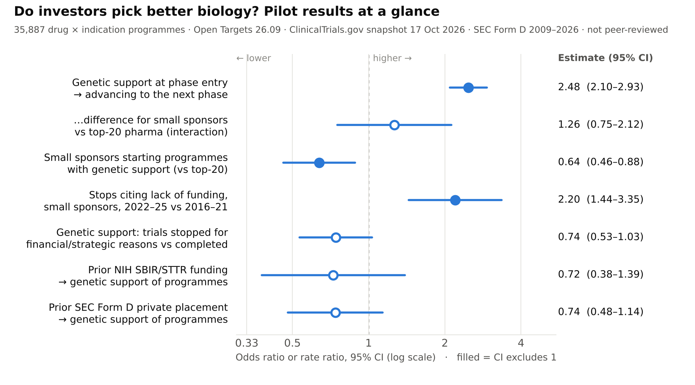

# Do investors pick better biology?

An independent research project by Mark Lapunov, built only from public data.

## The idea

Most new drugs fail in clinical trials. Drugs backed by **human genetic evidence** (DNA studies that link the
drug's target to the disease) succeed much more often, and this evidence is public and free.

**So do biotech companies, and the investors who fund them, actually choose such drugs?**

## What I did

I linked 35,887 drug projects to their clinical trials, to the genetic evidence for each drug, and to how each
company is financed. Everything comes from open sources (Open Targets 26.09, ClinicalTrials.gov, SEC filings,
NIH grants), and all the code is in this repository.

## What I found

1. **Genetic evidence works.** Projects that have it have about 2.5 times higher odds of moving to the next
   trial phase. This holds for small biotechs as much as for big pharma. Genetic evidence for an unrelated
   disease does not help.
2. **No sign that investors select on it.** Companies with private or venture money did not pick better-supported drugs.
3. **Small biotechs use it slightly less** than the 20 largest drug companies. A split by period, made after
   seeing the data, suggests that this gap opened only from 2016, and only in new uses of existing drugs.
4. **After 2022, trials were stopped for money about twice as often.** At small biotechs the rate jumped in 2022;
   at big pharma it had been rising steadily for years.
5. **The largest companies start more projects where new genetic evidence appears.** Whether the evidence is the
   reason, the data do not show.

The numbers

| Finding | Estimate (95% CI) |
|---|---|
| 1. Genetic evidence → moving to the next phase | odds ratio 2.48 (2.09–2.93) |
| 1. Placebo: genetic evidence only for unrelated diseases, vs no genetic evidence | odds ratio 0.84 (0.73–0.97) |
| 1. Genetic evidence for the disease, vs that placebo | odds ratio 2.76 (2.27–3.35) |
| 1. Difference between small biotechs and top-20 pharma in that effect | odds ratio 1.29 (0.77–2.15), not significant |
| 2. Private investment (SEC Form D filing) → projects with genetic evidence | odds ratio 0.71 (0.46–1.09) |
| 2. Venture-capital fund among the company's owners → projects with genetic evidence | odds ratio 0.76 (0.52–1.13) |
| 2. Government small-business grant (NIH SBIR/STTR) → projects with genetic evidence | odds ratio 0.71 (0.37–1.34) |
| 2. Corporate venture investor vs independent funds only | odds ratio 0.53 (0.16–1.80), few cases |
| 2. Share of the company held by venture funds at its IPO → projects with genetic evidence | odds ratio 1.02 (0.86–1.22) per 10 points of share |
| 3. Small biotechs starting projects with genetic evidence, vs top-20 pharma | odds ratio 0.68 (0.49–0.93) |
| 3. All other companies vs top-20 pharma, first trials before 2016 (split made after seeing the data) | odds ratio 1.14 (0.83–1.55), not significant |
| 3. The same, first trials from 2016 | odds ratio 0.68 (0.48–0.97) |
| 4. Trials stopped for lack of funding at small biotechs (up to 20 registered trials), 2022–25 vs 2016–21 | rate ratio 2.21 (1.45–3.37) |
| 4. Genetic evidence of trials stopped for money, vs completed trials (all years) | odds ratio 0.75 (0.54–1.04) |
| 4. Small biotechs: jump in stops for money in 2022, beyond the earlier trend | ratio 2.12 (1.23–3.67) |
| 4. Top-20 pharma: the same | ratio 1.34 (0.92–1.96) |
| 4. Short of cash at the end of 2021 → trial stopped for money in 2022–23 | odds ratio 1.58 (0.68–3.66) |
| 5. Top-20 pharma: new projects after genetic evidence is published | rate ratio 1.58 (1.03–2.41) |
| 5. Other companies: the same | rate ratio 0.85 (0.62–1.16) |
| 5. Other companies relative to top-20 pharma | ratio 0.54 (0.34–0.84) |
| 5. The same, each group of pairs compared only with pairs that never gained evidence | ratio 0.64 (0.39–1.04), not significant |
| 5. The same, compared with other diseases treated through the same target | ratio 0.85 (0.46–1.58) |
| 5. Other companies relative to top-20 pharma, with the top-20 list fixed by 2010 sales | ratio 0.56 (0.38–0.82) |
| 5. All companies: response to evidence published from 2016, relative to earlier evidence | ratio 1.38 (0.77–2.49), not significant |

Above 1 means more likely, below 1 less likely. If the range includes 1, the difference is not statistically
significant. 29,199 of the projects are in diseases where human genetic data exist. Full results, including the
ones that cut against these findings, are in [docs/results.md](docs/results.md).

## Good to know

* This is a pilot and has not been peer-reviewed.
* Investors are known by name only for companies that later went public and for funding rounds up to 2015.
* Twelve analyses and checks were planned in writing before they were run; two more have a written plan but are
  exploratory or illustrative, because related results had been seen ([plans](docs)); the rest are exploratory.
* The labels used to check how reasons for stopping a trial are classified were first made with AI assistance; an
  independent check by the author is under way.
* The code is tested automatically on every change, and the results can be rebuilt with `make`.

## More

[Detailed results](docs/results.md) · [Methods and limitations](docs/methods.md) ·
[How to run it](docs/pipeline.md) · [Data dictionary](docs/data_dictionary.md) · [Roadmap](docs/roadmap.md)

## Author

**Mark Lapunov**, MSc Bioscience Innovation and Enterprise, University College London.
[LinkedIn](https://www.linkedin.com/in/mark-lapunov-085909240) · [GitHub](https://github.com/lappunovmark)

To cite, use **Cite this repository**. Code is MIT-licensed; data keep their sources' licences, including CC BY 4.0
for the genetic-support data of Minikel et al. (2024), doi:10.1038/s41586-024-07316-0.
