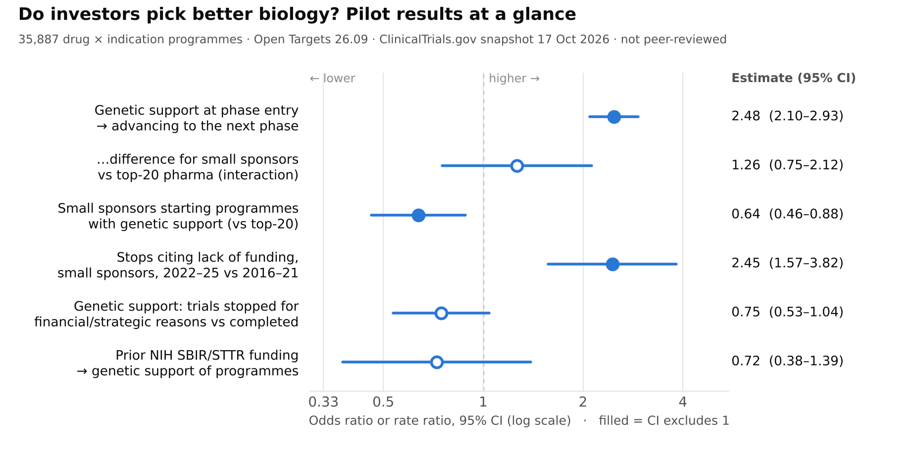

# Do investors pick better biology?

**Human genetic support × sponsor type × clinical success.** Independent research project by Mark Lapunov.

Drugs aimed at targets with human genetic evidence are more likely to succeed in clinical trials, and that evidence
is public before a programme starts. This project asks whether the companies running drug programmes, and the private
money behind them, choose targets with such evidence, and what happened to their trials when biotech funding fell
in 2022.

Everything is built from open data: Open Targets Platform 26.09 and ClinicalTrials.gov (35,887 drug × indication
programmes, 29,199 of them in indications with genetic data), NIH SBIR/STTR grants and SEC Form D private placements.

## Main findings (pilot, not peer-reviewed)

| Finding | Estimate (95% CI) |
|---|---|
| Programmes with genetic support are more likely to advance to the next clinical phase | OR 2.48 (2.10–2.93) |
| No significant difference in that effect between small sponsors and top-20 pharma | OR 1.26 (0.75–2.12) |
| Small sponsors start fewer programmes with genetic support than top-20 pharma | OR 0.64 (0.46–0.88) |
| Small sponsors stopped trials for lack of funding more often in 2022–25 than in 2016–21 | rate ratio 2.45 (1.57–3.82) |
| Trials stopped for financial or strategic reasons carried no more genetic support than completed trials | OR 0.75 (0.53–1.04) |
| Sponsors that raised private money (SEC Form D) did not pick better-supported targets | OR 0.66 (0.41–1.05) |
| Nor did sponsors with earlier NIH SBIR/STTR grants | OR 0.72 (0.38–1.39) |

**In short:** genetic evidence pays off for every kind of sponsor, but small biotechs use it less, and raising private
money does not go with better-supported targets.

OR: odds ratio from logistic regressions adjusted for period, therapeutic area, modality and, where relevant, phase
and sponsor group, with standard errors clustered by drug. Small sponsors: industry sponsors with at most 5 drugs (programme models) or at most
20 trials (trial-stop model).

**Limits.** Sponsor size and Form D filings stand in for venture backing, which is not measured directly yet. The
stop-reason classifier is validated against provisional labels ([#2](https://github.com/lappunovmark/vc-genetics-pilot/issues/2)),
and most approvals carry no date ([#4](https://github.com/lappunovmark/vc-genetics-pilot/issues/4)).

## More
* [Detailed results, validation and corrections](docs/results.md)
* [Methods and limitations](docs/methods.md) · [Data dictionary](docs/data_dictionary.md)
* [Pipeline, how to run it, checks and licences](docs/pipeline.md): `make all` rebuilds everything, `make check` runs
  the tests
* [Open issues and next steps](https://github.com/lappunovmark/vc-genetics-pilot/issues)

## Author
**Mark Lapunov**, MSc Bioscience Innovation and Enterprise, University College London. Previously a research intern
at Skoltech, the Russian Academy of Sciences and Westlake University.
[LinkedIn](https://www.linkedin.com/in/mark-lapunov-085909240) · [GitHub](https://github.com/lappunovmark)

To cite, use **Cite this repository** (from `CITATION.cff`). Code is MIT-licensed; data keep their sources' licences,
including CC BY 4.0 for the genetic-support data of Minikel et al. (2024), doi:10.1038/s41586-024-07316-0.
