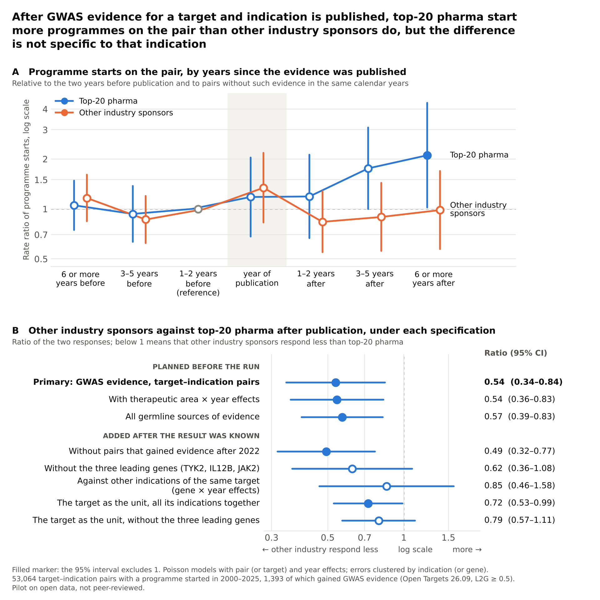

# Do investors pick better biology?

An independent research project by Mark Lapunov, built only from public data.

## In one minute

**The question.** Most new drugs fail in clinical trials. One of the best early clues that a drug will work is
**human genetic evidence**: studies of human DNA that link the gene the drug acts on to the disease it is meant to
treat. Drugs with this evidence succeed much more often (Minikel et al., *Nature*, 2024), and the evidence is often
public before a drug project starts. So do biotech companies, and the investors who fund them, choose drugs that
have it? And when biotech funding dried up in 2022, did companies drop their best projects for lack of money?

**What I built.** A reproducible pipeline that links 35,887 drug–disease projects to their clinical trials, to
the genetic evidence for each drug target, and to how each sponsor is financed: private placements, owners, venture
rounds, public grants and cash on hand, all from open records. Every number below is produced by the code in this
repository and can be rebuilt with `make`.

**What I found.** Genetic evidence predicts success equally well for small biotechs and big pharma, yet no marker
of private or venture financing goes with better-supported drug targets. The largest companies run more of the
projects on targets that gain genetic evidence, but the pilot does not show that the evidence is the reason. After
2022, trials stopped for money about twice as often at every kind of company.

## What I found

1. **Genetic evidence works for everyone.** Drug projects with it had about 2.5 times higher odds of moving on to
   the next trial phase, and this was true for small biotechs as much as for big pharma.
2. **Small biotechs use it somewhat less.** Among projects started in the same years, in the same disease area and
   with the same type of drug, they start fewer projects with genetic evidence than 20 of the largest drug
   companies. Mid-sized and large companies outside that group do not differ from it.
3. **Investor money did not lead to better choices.** Companies that had raised private investment did not pick
   drugs with more genetic evidence, and neither did companies with venture-capital funds among their owners or
   with US government small-business grants. Companies backed by corporate venture investors did not differ from
   those backed by independent funds (few cases). One small comparison points the other way: among companies that
   went public, the venture-backed ones had more genetic evidence on one of the two evidence measures.
4. **After 2022, trials were stopped for financial reasons about twice as often**, at big pharma as much as at
   small biotechs. Stops that cite lack of funding are rare and almost all at small biotechs, where they more than
   doubled. Trials stopped for financial or business reasons did not have stronger genetic evidence than trials
   that were completed, and companies that entered 2022 short of cash did not clearly stop more trials.
5. **When new genetic evidence is published, the largest companies start more projects on that target and
   disease, and other companies do not.** This analysis was planned before it was run. Checks added afterwards
   limit what it means: two fifths of the effect is one class of drugs moving through related immune diseases,
   and the largest companies did not favour the disease that gained the evidence over other diseases treated
   through the same target. So the pilot shows where the largest companies were, not that the evidence led them
   there.

The numbers behind each finding

| Finding | Estimate (95% CI) |
|---|---|
| 1. Genetic evidence → moving to the next phase | odds ratio 2.48 (2.09–2.93) |
| 1. Difference between small biotechs and top-20 pharma in that effect | odds ratio 1.29 (0.77–2.15), not significant |
| 2. Small biotechs starting projects with genetic evidence, vs top-20 pharma (same period, disease area and drug type) | odds ratio 0.68 (0.49–0.93) |
| 3. Private investment (SEC Form D filing) → projects with genetic evidence | odds ratio 0.71 (0.46–1.09) |
| 3. Government small-business grant (NIH SBIR/STTR) → projects with genetic evidence | odds ratio 0.71 (0.37–1.34) |
| 3. Venture-capital fund among the company's owners (SEC Schedules 13D and 13G) → projects with genetic evidence | odds ratio 0.76 (0.52–1.13) |
| 3. Corporate venture investor vs independent funds only → projects with genetic evidence | odds ratio 0.53 (0.16–1.80), 16 supported projects |
| 4. Small biotechs' trials stopped for lack of funding, 2022–25 vs 2016–21 | rate ratio 2.21 (1.45–3.37) |
| 4. Genetic evidence of trials stopped for financial or business reasons, vs completed trials | odds ratio 0.75 (0.54–1.04) |
| 4. Short cash runway at the end of 2021 → trial stopped for financial reasons in 2022–23 (planned) | odds ratio 1.58 (0.68–3.66) |
| 5. Top-20 pharma: new projects on a target and disease after genetic evidence is published (planned) | rate ratio 1.58 (1.03–2.41) |
| 5. Other industry sponsors: the same | rate ratio 0.85 (0.62–1.16) |
| 5. Other industry sponsors relative to top-20 pharma (planned main estimate) | ratio 0.54 (0.34–0.84) |
| 5. The same ratio against other diseases treated through the same target (added afterwards) | ratio 0.85 (0.46–1.58) |

Above 1 means more likely, below 1 less likely; if the range includes 1, the difference is not statistically
significant. Small biotechs are companies with at most 5 drugs (or at most 20 trials for finding 4). "Planned" means
that the analysis plan was committed to this repository before the analysis was run.

## How it was built

* **Data linked by hand-checked rules.** Projects and trials come from Open Targets Platform 26.09 and all 463,466
  interventional studies on ClinicalTrials.gov. Trial sponsors are matched by name to 50,125 NIH small-business
  awards, 40,995 SEC Form D filings on private fundraising, SEC ownership filings (Schedules 13D and 13G), year-end
  cash from SEC financial data, venture rounds in a 2015 Crunchbase export and a list of venture-backed IPOs.
  Every name match that was not exact is written out with the decision and its reason
  (`pilot/*_decisions.csv`, `results/*_review.csv`).
* **Checked against published work.** The genetic-support code reproduces all 1,258 supported target–disease
  pairs in the data of Minikel et al. (2024) exactly. A rule-based classifier of stated stop reasons agrees with
  reference labels on 83.0% of 200 held-out texts (Cohen's κ 0.79); blind re-coding of those labels by the author
  is the next step ([roadmap](docs/roadmap.md)).
* **Plans before results.** Three analyses were planned in writing before they were run
  ([evidence arrival](docs/plan_evidence_arrival_ot.md), [its venture split](docs/plan_evidence_arrival_venture.md),
  [cash runway](docs/plan_cash_runway.md)); the commit history shows the order. Everything else is labelled
  exploratory, and every check added after a result was known is labelled as such.
* **Results that do not flatter are reported.** The main selection result is shown under every specification
  ([figure](figures/main_results.png)), and corrections to earlier versions are listed at the end of
  [docs/results.md](docs/results.md).
* **Tested and reproducible.** 124 unit tests and checks that the numbers in this README match the model output
  run on every push; the core result files were reproduced on a second machine.

## What is in the repository

| Folder | Contents |
|---|---|
| [`pilot/`](pilot) | The pipeline: 48 Python scripts that download the sources, link them, fit the models and draw the figures |
| [`results/`](results) | Model output as text and tables, one file per analysis ([data dictionary](docs/data_dictionary.md)) |
| [`docs/`](docs) | [Detailed results](docs/results.md), [methods and limitations](docs/methods.md), [pipeline and how to run it](docs/pipeline.md), the three analysis plans, [roadmap](docs/roadmap.md) |
| [`factcheck/`](factcheck) | Scripts that re-check the pipeline against its sources, and the materials for blind double-coding of stop reasons |
| [`tests/`](tests) | Unit tests and README-versus-results consistency checks |

## Data and limits

35,887 drug–disease projects (29,199 of them in diseases where human genetic data exist) from Open Targets Platform
26.09 and ClinicalTrials.gov, linked to NIH RePORTER grant records and SEC filings. The Crunchbase export and the
IPO list are not redistributed here, so the tables derived from them are written by the scripts and are not in the
repository.

This is a pilot and has not been peer-reviewed. Company size and Form D filings stand in for venture capital.
Investors are named only for companies that later became public (and then only holders above 5%) and for venture
rounds up to 2015; investor-level data on later private rounds are the main gap. The top-20 group is fixed by 2023
sales, after the projects studied, so it partly reflects which projects succeeded.

## Author

**Mark Lapunov**, MSc Bioscience Innovation and Enterprise, University College London. Previously a research intern
at Skoltech, the Russian Academy of Sciences and Westlake University.
[LinkedIn](https://www.linkedin.com/in/mark-lapunov-085909240) · [GitHub](https://github.com/lappunovmark)

To cite, use **Cite this repository** (from `CITATION.cff`). Code is MIT-licensed; data keep their sources' licences,
including CC BY 4.0 for the genetic-support data of Minikel et al. (2024), doi:10.1038/s41586-024-07316-0.
