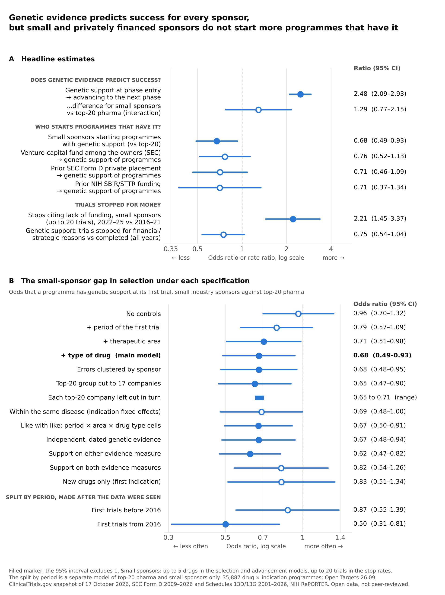

# Pilot results in detail

Open Targets Platform 26.09 and ClinicalTrials.gov snapshot of 17 October 2026. Pilot results, not peer-reviewed.
Model output is in `results/` ([data dictionary](data_dictionary.md)); definitions are in [methods](methods.md).

## Estimates
* 35,887 drug × MeSH-indication programmes; 29,199 in indications with genetic insight.
* Ex-ante genetic support at phase entry: OR 2.48 (2.09–2.93) for advancing a phase; no difference between small
  industry sponsors and top-20 pharma (interaction OR 1.29, 0.77–2.15).
* Small industry sponsors start fewer programmes with ex-ante support once the period of the first trial, the
  therapeutic area and the modality are held fixed (adjusted OR 0.68, 0.49–0.93); not significant for novel drugs
  (0.83, 0.51–1.34). The unadjusted shares barely differ (4.3% of small sponsors' programmes against 4.5% for top-20
  pharma; unadjusted OR 0.96, 0.70–1.32; 0.79 with the period alone, 0.71 with period and area). The gap opens within
  periods and areas because small sponsors' programmes are more recent (52% first trialled in 2015 or later, against
  29% for top-20 pharma), when dated genetic support is more common, and less often in oncology (31% against 46%),
  where it is rare. The adjusted estimate does not depend on how the errors are clustered or on any one company:
  clustered by sponsor instead of drug it is 0.68 (0.48–0.95); leaving out each top-20 company in turn gives 0.65
  to 0.71 (p ≤ 0.04 every time); cutting the top-20 group to the 17 companies with the largest 2023 sales gives
  0.65 (0.47–0.90). Within one disease (indication fixed effects, 248 indications where support varies) it is 0.69
  (0.48–1.00; conditional logit 0.70, 0.51–0.95), and within cells of period × area × modality (Mantel–Haenszel)
  0.67 (0.50–0.91). Counting support on either of the two evidence measures (1,464 supported programmes instead
  of 959) gives 0.62 (0.47–0.82); requiring both (443 programmes) gives 0.82 (0.54–1.26).
* What lies behind that gap (`h1_mechanisms.py`; exploratory: the splits were chosen after the result was known, so
  the p-values are descriptive; this script pools sparse control categories and gives 0.67 for the main model).
  *Type of evidence:* the gap is in support from dated population genetics (OTG, PICCOLO, Genebass; OR 0.52,
  0.34–0.78) and absent for support from OMIM only (0.95, 0.61–1.50); a multinomial model puts the difference
  between the two at p = 0.06. *Novel and follow-on:* for a drug's first indication there is no clear gap (0.83,
  0.51–1.34); it comes from new indications of drugs already in trials (0.57, 0.38–0.86). *Partnerships:* without the
  non-top-20 programmes that have a top-20 collaborator on the first trial it is 0.66 (0.48–0.92), without those with
  any industry collaborator 0.67 (0.48–0.94). *Trial size:* on the 71% of programmes whose indication has a typical
  Phase 3 size (median enrolment of other drugs' Phase 3 trials), the gap is 0.62 (0.43–0.88) without and 0.61
  (0.43–0.87) with that size as a control, and does not vary with it (interaction 1.00, 0.32–3.10). *Capital:*
  sponsors that had raised at least the cost of one typical Phase 3 in Form D offerings before the first trial did
  not start better-supported programmes than sponsors without a Form D (0.64, 0.34–1.22; less than that cost 0.74,
  0.36–1.52; among filers, at least one Phase 3 against less 1.01, 0.41–2.48). *Acquisitions:* 154 top-20 programmes
  of 60 drugs carry the research code of a company that the same parent acquired only after the programme's first
  trial, so the registry moved them to the acquirer; dropping or re-typing them leaves 0.67–0.69. Sponsors that a
  top-20 company later acquired did not start clearly better-supported programmes (1.21, 0.74–1.97). Partnerships,
  trial size, capital and acquisitions do not account for the gap; the first two splits narrow it down to dated
  population evidence in follow-on indications (0.47, 0.29–0.75).
* Approval dates: 1,205 of 26,542 phase entries advance through an approval alone; 619 of these approvals can be dated
  (EMA or PMDA report, else ChEMBL first approval) before the entry year and are probably approvals that preceded the
  trial. Removing them leaves the genetic premium at OR 2.53 (2.12–3.01); counting only dated approvals gives 2.50
  (2.10–2.98); trials only, 2.25 (1.87–2.69). The small-sponsor interaction stays non-significant (1.54, 0.92–2.59).
* Financial or strategic trial stops per 1,000 active trial-years rose 2.0–2.5-fold from 2016–21 to 2022–25 in every
  industry group. Among small sponsors, stops citing lack of funding rose 2.21-fold (1.45–3.37); in the other groups
  such stops are rare.
* Trials stopped for financial or strategic reasons carried no more ex-ante genetic support than completed trials
  (8.9% vs 10.4%; adjusted OR 0.75, 0.54–1.04, most clearly in trials that ended in 2022 or later). Whether they
  carried less depends on the measure: without undated OMIM evidence the overall gap is not significant (OR 0.88,
  0.62–1.24), and with the independent measure built from Open Targets germline evidence dated by Falaguera et al.
  there is no gap at all (11.1% vs 11.5%; OR 0.90, 0.65–1.24; trials ending 2022 or later OR 1.03, 0.71–1.49).
* Prior NIH SBIR/STTR funding of the sponsor is not linked to ex-ante support (OR 0.71, 0.37–1.34; with the dated
  Open Targets measure 0.81, 0.48–1.37).
* SEC Form D: 40,995 filings (33,956 offerings once amendments are folded into the offering they restate) by
  biotech, pharma and other health care issuers (2009 Q1–2026 Q3); 801 of 2,999 non-top-20 industry sponsor names
  matched to an issuer (751 on identical names up to legal form, 50 accepted after hand review; 15 candidate matches
  not used). Among programmes first trialled in 2010 or later, sponsors with
  a prior Form D started genetically supported programmes no more often (4.0% vs 5.8%; adjusted OR 0.71, 0.46–1.09)
  and advanced no more often (adjusted OR 0.88, 0.72–1.09). Genetic support predicted advancement in both groups and,
  in this version of the linkage, more strongly among Form D filers (interaction OR 2.04, 1.05–3.94); the interaction
  was 1.58 (0.75–3.30) before the linkage fixes of 6 November 2026, so it should be read as fragile. Dating the first
  Form D by own names only gives OR 0.74 (0.48–1.15) for selection and 0.91 (0.73–1.13) for advancement; the
  whole-CIK dating changes no flag in the analysis window. With the dated Open Targets measure the selection OR is
  0.72 (0.45–1.14). Restricting both groups to sponsors classified as US-based (`pilot/sponsor_region.py`: US
  financing records, else legal form and place names; 2,047 programmes, 46% with a prior Form D) gives OR 0.80
  (0.47–1.35) for selection, 0.90 (0.69–1.17) for advancement and an interaction of 0.99 (0.43–2.29), so the
  significant interaction in the full sample reflects the mix of US and non-US sponsors among non-filers.
* Amount raised: summing the amounts sold in the sponsor's Form D offerings before the first trial (3,060 offerings of
  the 801 linked sponsors, median $6.0M) shows no dose–response. Programmes of sponsors that had raised under $10M,
  $10–50M and $50M or more had ex-ante support in 4.2%, 4.7% and 3.2% of cases against 5.8% without a prior Form D
  (adjusted OR 0.73, 0.38–1.39; 1.04, 0.55–1.94; 0.49, 0.23–1.06); among filers, each tenfold increase in the amount
  raised changes the odds of support by 0.85 (0.56–1.30). Advancement does not rise with the amount either (0.93,
  0.72, 1.02 for the three bands; log-linear 1.12, 0.85–1.48 among filers). Counting only equity offerings outside
  business combinations, the best-funded band is lower still (2.6% supported; OR 0.40, 0.19–0.82, on eight supported
  programmes) while the log-linear trend among filers stays non-significant (0.81, 0.55–1.20); in 2024 dollars the
  top band gives 0.47 (0.23–0.96). If anything, the sponsors with the most private capital behind them picked
  less-supported targets.
* Who owns the sponsor (`owners_link.py`, `owners_models.py`): 1,077 of the 2,999 non-top-20 industry sponsor names
  have a legal entity on EDGAR (801 through Form D, 782 as registrants; 109 name matches accepted and 90 rejected by
  hand), 745 are named in a Schedule 13D or 13G together with another party (2001–2026), and for 425 one of those
  parties is a venture-capital fund (filer names classified by `pilot/investor_classes.tsv`, read by hand; 24% of
  sponsor–owner pairs, mostly individuals and companies, stay unclassified). Programmes of sponsors with a
  venture-capital owner had ex-ante support no more often (3.8% against 4.9% for other public sponsors and 5.5% for
  sponsors that never registered; adjusted OR 0.76, 0.52–1.13; among public sponsors only 0.95, 0.57–1.57). The
  answer does not depend on how the marker is drawn: a venture owner already there when the sponsor went public
  0.94 (0.60–1.47); a venture filing dated by the year of the first trial 0.67 (0.42–1.08); a venture or crossover
  owner 0.80 (0.57–1.13); with the dated Open Targets measure 0.98 (0.67–1.42). Their phase entries advanced
  slightly more often, a borderline difference (OR 1.19, 1.00–1.42, p = 0.05; among public sponsors only 1.16,
  0.91–1.47), and genetic support predicted advancement to the same degree (interaction 1.09, 0.60–1.97).
  Ownership is seen only for sponsors that became public and only for holders above 5%, at or after the filing, so
  the main marker is a property of the sponsor, not dated to the trial.
* Venture rounds with named investors (`cb_models.py`; exploratory, Crunchbase export of December 2015, first
  trials 2001–2016): 354 of 992 non-top-20 industry sponsor names are found in Crunchbase (396 candidate name
  matches, 40 rejected, 10 of them by hand), 302 have a round of type "venture" and 189 a venture round that names a
  venture or crossover fund. Programmes of sponsors with a venture round before the year of the first trial had
  ex-ante support no more often (OR 0.74, 0.44–1.26; among sponsors found in Crunchbase 1.00, 0.47–2.15; with a named
  fund 0.56, 0.29–1.08; with the dated Open Targets measure 0.73, 0.43–1.26), and their phase entries advanced no
  more often (1.02, 0.83–1.27). Crunchbase coverage is incomplete and ends in 2015, so sponsors not found are not
  known to be without venture money.
* Venture backing at the IPO as an outside check (`ritter_models.py`; exploratory; Jay Ritter's list of US IPOs
  1975–2025, version of 19 January 2026): 275 non-top-20 industry sponsors have a US IPO in the list and 232 of them
  were venture-backed at the IPO. Against this flag the pilot's markers are precise but incomplete. The venture-owner
  marker from Schedules 13D/13G finds 77% of Ritter's venture-backed IPOs, and Ritter confirms 94% of the sponsors it
  marks (269 sponsors; dated at the IPO, for IPOs of 2001 or later: 82% found, 97% confirmed, 210 sponsors). A
  Crunchbase venture round by the IPO year finds 91%, with 97% confirmed (98 sponsors). Nearly all sponsors that went
  public were venture-backed, so the comparison among them rests on 43 sponsors without venture backing, many of
  them specialty-pharma companies and subsidiaries: venture-backed sponsors had ex-ante support more often there (OR
  2.10, 0.66–6.65; with the dated Open Targets measure 2.85, 1.15–7.06).
* Venture investors on the board (`formd_directors.py`; exploratory): Form D names the issuer's directors, and
  venture funds file Form D too and name their managers (13,868 distinct names). Of 50,312 outside directors of
  biopharma issuers 11.5% carry the name of a venture-fund manager, against 2.7% of executive officers who are not
  directors. Of the 801 sponsors whose Form D filings name people, 356 have a venture investor on the board (347 by
  the name of a director, the others by a "care of" address of a venture firm). Where an outside flag exists the
  marker is precise and incomplete: it finds 79% of Ritter's venture-backed IPOs and Ritter confirms 97% of the
  sponsors it marks (124 sponsors), and it finds 58% of the sponsors with a Crunchbase venture round, 93% confirmed
  (214 sponsors). Programmes of sponsors with a venture investor on the board before the first trial had ex-ante
  support no more often (OR 0.74, 0.43–1.25; against other sponsors with a prior Form D 1.04, 0.48–2.24; dated Open
  Targets measure 0.85, 0.45–1.60 and 1.57, 0.67–3.69), and their phase entries advanced no more often (0.92,
  0.71–1.20).
* The four venture markers together (`vc_combined.py`; exploratory): 506 of 1,436 non-top-20 industry sponsors are
  venture-backed by at least one source (owners in Schedules 13D/13G, Ritter's IPO flag, a Crunchbase venture round,
  a venture investor on the board in Form D), 274 by at least two, and 689 are seen in at least one source. The
  selection estimate is 0.75 (0.54–1.03) against all other sponsors and 1.20 (0.72–1.99) among the sponsors seen
  (two sources or more: 1.12, 0.71–1.79; dated Open Targets measure: 0.72, 0.53–0.98 and 1.01, 0.65–1.58). The sign
  depends on the comparison group: venture-backed sponsors do no better than sponsors about whose financing nothing
  is known, and no worse than the other sponsors that are seen. No comparison shows that they pick better-supported
  targets.
* Selection by type of drug (`h1_by_modality.py`; exploratory): the small-sponsor gap is not the same for every
  type of drug. Among small molecules the programmes of small sponsors are supported about as often as those of
  top-20 pharma (54 of 1,256, 4.3%, against 119 of 3,181, 3.7%; adjusted OR 0.85, 0.56–1.29). Among antibodies they
  are supported less often (5 of 235, 2.1%, against 70 of 1,398, 5.0%; OR 0.23, 0.08–0.62; mid-size sponsors 2 of
  416, OR 0.18, 0.04–0.77); for proteins the estimate is 0.55 (0.22–1.38), and for nucleic acid, gene and cell
  therapies the shares are 5 of 48 against 11 of 39 (the model does not converge). The difference between types is
  not established: small sponsor × biologic 0.61 (0.30–1.26), small sponsor × antibody 0.38 (0.13–1.08, p = 0.07),
  and the antibody estimate rests on five supported programmes of small sponsors.
* Direction of effect (`extract_ot_direction.py`, `direction_models.py`; exploratory): the support flag does not
  say whether the drug moves the target the way the genetics suggests. Open Targets 26.09 assesses a direction for
  gene burden, ClinVar, Orphanet and Gene2Phenotype evidence (not for GWAS) and for the drug's action. Of 29,191
  programmes with insight, 1,177 have such evidence on a target and 370 are concordant (the drug's direction is the
  one the genetics asks for). Concordant support is no rarer among small sponsors than at top-20 pharma: 42 of 1,906
  programmes (2.2%) against 83 of 5,130 (1.6%), adjusted OR 1.25 (0.78–2.02); with evidence dated before the first
  trial 14 against 27 programmes, 0.96 (0.47–1.97); without gene burden evidence 1.40 (0.81–2.44) and 1.04
  (0.50–2.15). Large and mid-size sponsors outside the top 20 have it more often (1.97, 1.21–3.19, and 1.42,
  0.93–2.18). These sources are rare-variant evidence, for which the main analysis found no gap either (support from
  OMIM only: 0.95, 0.61–1.50); the gap sits in dated population genetics, which carries no direction assessment.
  The 686 programmes with only discordant evidence are not interpreted: Open Targets assesses ClinVar for
  loss-of-function variants only, and the genes most often discordant are oncogenes and ion channels whose diseases
  come from gain of function.
* Programme starts around the publication of genetic evidence (`evidence_arrival.py`; exploratory): of 53,064
  target × indication pairs with a programme started in 2000–2025, 822 gained their first dated supporting
  association in 2007–2022 and 52,012 were never supported (230 pairs with OMIM support are left out). Starts on a
  pair decline over its life whether or not evidence arrives (a placebo evidence year five years early gives rate
  ratio 0.71, 0.59–0.85), so the before-after change (0.81, 0.66–1.00) is not an effect of the evidence. The contrast
  between sponsor groups removes that common decline: after the evidence year other industry sponsors start
  programmes on the pair at 0.60 (0.37–0.95) of the rate of top-20 pharma, each measured against its own calendar
  trend (0.61, 0.40–0.95 with area × year effects; 0.60, 0.38–0.95 with errors clustered by gene). The groups did not
  diverge before the evidence year (leads 1.14 and 1.06; placebo of the contrast 0.94, 0.56–1.56). The result is
  fragile: on pairs where both groups started programmes it is 0.70 (0.38–1.28), and for novel programmes (a drug's
  first indication) there is no difference (0.97, 0.41–2.27). The raw rates on pairs with evidence fall by a similar
  proportion in both groups; they differ because other industry sponsors started more programmes over time
  elsewhere and top-20 pharma fewer.
* Corporate and independent venture investors (`cvc_models.py`; exploratory): the venture markers do not separate
  venture arms of drug companies from independent funds. *Private rounds* (Crunchbase, first trials 2001–2016): of
  302 sponsors with a venture round, 83 have a corporate investor (70 a drug or medical-technology company or its
  venture arm) and 186 an independent fund. Programmes with a corporate investor before the first trial were
  supported in 5 of 218 cases (2.3%), those with independent funds only in 11 of 336 (3.3%) and those without a
  venture round in 140 of 3,060 (4.6%). Corporate against independent backing: OR 0.53 (0.16–1.80) on 16 supported
  programmes (drug and medical-technology companies only 0.55, 0.14–2.26). Against programmes without a venture
  round the corporate group is lower (0.29, 0.10–0.86; with foundation-owned investors counted as corporate 0.27,
  0.09–0.80), but not on the dated Open Targets measure (0.97, 0.43–2.17). Their phase entries advanced no more
  often (0.83, 0.51–1.35, against independent funds). *Owners of public sponsors* (Schedules 13D/13G): of 782
  registrants, 224 have a large drug company or its venture arm among the owners and 420 a venture fund (161
  both). Corporate against venture-fund owners only: 0.94 (0.47–1.88; dated Open Targets measure 0.91, 0.48–1.71;
  with owners dated by the year of the first trial 1.25, 0.56–2.81); advancement 0.87 (0.67–1.14). No comparison
  shows that sponsors with corporate backing choose better-supported targets than sponsors backed by independent
  funds, and every direct comparison is imprecise. One side result: entries of sponsors that had venture-fund owners
  and no corporate owner by the year of the entry advanced more often than those of public sponsors without either
  (1.60, 1.20–2.15); it was not looked for and is reported as found.
* Venture backing and trial stops (`vc_stops.py`; exploratory; the same 86,273 trial-years): of 7,783 non-top-20
  industry trial sponsors, 2,423 are seen in at least one of the four sources and 1,779 are venture-backed.
  Financial or strategic stops per 1,000 active trial-years rose from 11.0 in 2016–21 to 27.7 in 2022–25 for
  venture-backed sponsors (rate ratio 2.52, 2.09–3.03), from 10.4 to 22.5 for sponsors seen without a venture marker
  (2.17, 1.49–3.17) and from 6.5 to 15.6 for sponsors not seen (2.40, 2.00–2.88). The rise is not larger for
  venture-backed sponsors: the interaction is 1.17 (0.65–2.11) against the sponsors seen without a marker (1.18,
  0.65–2.14 among seen sponsors only; 0.62, 0.31–1.25 among small sponsors; stops citing lack of funding 0.56,
  0.16–1.96, on 113 events; any stop 1.12, 0.85–1.47). The stops rose for every kind of sponsor; the data do not
  show that venture-backed sponsors were hit harder.
* Evidence arrival repeated on Open Targets 26.09 evidence (`extract_ot_dated.py`, `evidence_arrival.py` with the
  evidence file; plan written before the run: `docs/plan_evidence_arrival_ot.md`). Primary evidence: GWAS credible
  sets with L2G ≥ 0.5, dated by Open Targets; 1,393 of the 53,064 pairs gained such evidence. After the evidence
  year top-20 pharma started more programmes on the pair (rate ratio 1.58, 1.03–2.41; placebo 0.95, 0.70–1.30) and
  other industry sponsors did not (0.85, 0.62–1.16; small 0.92, 0.57–1.48; mid-sized and large 0.85, 0.57–1.27;
  academic and government 0.96, 0.77–1.20). The contrast of other industry against top-20 pharma is 0.54
  (0.34–0.84); with area × year effects 0.54 (0.36–0.83); clustered by gene 0.54 (0.36–0.81); leads 1.11 and 0.93;
  placebo of the contrast 0.87 (0.60–1.25). Mid-sized and large sponsors 0.54 (0.34–0.87), academic and government
  0.61 (0.38–0.97), small sponsors 0.58 (0.30–1.11), pairs where both groups started programmes 0.61 (0.32–1.17),
  novel programmes 0.73 (0.24–2.22). With all germline sources (2,069 pairs; 102 with undated evidence left out)
  the contrast is 0.57 (0.39–0.83; area × year 0.67, 0.46–0.99; small sponsors 0.56, 0.32–0.98), with a borderline
  placebo (0.75, 0.55–1.03). By the reading rule fixed in advance the first result is repeated. The two evidence
  sets overlap, so this is a repetition on a larger and partly newer set, not an independent sample.
* Venture-backed sponsors and the publication of genetic evidence (section F of `evidence_arrival.py`; plan written
  before the run: `docs/plan_evidence_arrival_venture.md`). Of 1,446 non-top-20 industry sponsors with a programme
  on these pairs, 513 are venture-backed by the combined flag. On GWAS evidence, venture-backed sponsors did not start
  more programmes after the evidence year (0.84, 0.52–1.36; sponsors without a venture marker 0.79, 0.54–1.16) and
  did not respond more than industry sponsors without a marker (1.06, 0.58–1.95). The primary contrast, against
  top-20 pharma, is 0.53 (0.28–1.00, p = 0.05): by the rule fixed in advance the interval includes 1, so the primary
  evidence does not separate the two, although the contrast is separated with area × year effects (0.46, 0.24–0.87)
  and on all germline sources (0.58, 0.36–0.94; against sponsors without a marker there 1.10, 0.67–1.80). Sponsors
  without a marker are separated from top-20 pharma (0.50, 0.31–0.80). Placebo of the primary contrast 1.13
  (0.69–1.83); the placebo of the comparison between venture-backed and other sponsors is borderline (1.56,
  0.96–2.54), which makes that comparison the weakest part.
* Capital raised and trial stops (`formd_stops.py`; non-top-20 industry trials, 86,273 active trial-years 2016–25):
  financial or strategic stops rose after 2022 in every band of capital raised before the trial (rate ratios 2.4 with
  no prior Form D, 2.4 under $10M, 2.9 at $10–50M, 1.7 at $50M or more), with no steeper rise for less-funded sponsors
  (interactions 1.03, 1.25, 0.73). Sponsors with $50M or more behind them stopped trials for financial or strategic
  reasons more often throughout (OR 1.60, 1.20–2.14), but among sponsors classified as US-based the excess is small
  (1.26, 0.88–1.79), so it partly reflects non-US sponsors among those without a Form D. Stops citing lack of
  funding (113 in all) were somewhat more frequent among sponsors with under $50M raised (OR 2.31, 1.01–5.26 under
  $10M and 2.45, 1.03–5.82 at $10–50M, on 7 and 9 such stops; no excess at $50M or more, OR 1.01; among US-based
  sponsors 1.79, 0.72–4.48 and 1.98, 0.84–4.70), too few to make much of.

## Validation
* `gensup.py` reproduces all 1,258 genetically supported target–indication pairs in Minikel et al.'s data exactly
  (OMIM, OTG, PICCOLO and Genebass evidence; commit b84cf05; no pairs missing or added).
* Genetic insight for indications outside their set: the approximation agrees with their label for 96.6% of their
  1,013 indications with a MeSH ID.
* Replication note: in their data, the Phase I→launch RS computed as the product of phase-wise RS, as described in
  their Methods (1.076 × 1.571 × 1.275), is 2.16, while the ratio of launch shares among programmes entering phase I
  is 2.63, close to the headline 2.6. Both are reported in `results/robust.txt` for comparison.
* Stop-reason classifier v4 (provisional): 83.0% agreement with reference labels on 200 held-out texts (Cohen's
  κ 0.79); financial or strategic class precision 0.91, recall 0.86. These are the same as for v3, which v4 extends:
  on the held-out texts v4 gains one and loses one (94.3% against 93.8% on the 400 tuning texts), so the changes are
  neutral there and matter only in the full data, where more stops are classed as financial or strategic
  (Corrections below). Every pattern has support outside the held-out texts (`factcheck/stopreasons_support.py`,
  `results/stopreasons_support.txt`). Against the independent BERT classifier of Razuvayevskaya et al. (2024; Open
  Targets StopReasons predictions for 28,561 stopped trials, `factcheck/stopreasons_crosscheck.py`), our
  financial-or-strategic class plus unspecified sponsor decisions and their "business or administrative" class agree
  with κ 0.79 over all trials and 0.82 on the 2,345 industry trials of the H4 sample (each side recovers 87–89% of
  the other); enrolment κ 0.83, COVID-19 0.93, efficacy 0.73, safety 0.61 on that sample. The reference labels in
  `results/rq2_hand_labels.csv` are an LLM-assisted first pass that has not yet been blind double-coded by the author
  ([roadmap](roadmap.md); the coding sheet, codebook and scoring script
  are in `factcheck/double_coding/`), so these figures may change.

## Corrections
* 12 Nov 2026 (third entry of the day): Biohaven and Upjohn. `sponsors.py` counted every sponsor name with
  "Biohaven" as Pfizer from 2022. Pfizer bought Biohaven's migraine business on 3 October 2022; the rest of the
  pipeline was spun off the next day as the independent Biohaven Ltd., and the Biohaven names left in the registry
  (Biohaven Pharmaceuticals, Inc.; Biohaven Therapeutics Ltd.) are that company's. The entry is removed: 19 trials
  that started in 2022 or later are no longer typed top-20. Upjohn, which left Pfizer for Viatris in November 2020,
  now stops counting from 2020 like the other spun-off units (one trial, withdrawn in 2021 because "the project has
  been transferred to Viatris"). No programme or phase entry of the panel changes, so Tables P1, P2 and P4 and all
  selection, advancement, SBIR and Form D selection results are unchanged. The trial-stop tables move because one
  pre-2022 stop goes from top-20 pharma to large sponsors and one post-2022 stop from top-20 to mid-sized
  sponsors: large sponsors 9.1 → 22.2 per 1,000 trial-years, rate ratio 2.45 (1.66–3.61;
  before: 2.51, 1.70–3.71); top-20 2.18 (1.83–2.60); mid-sized 2.01 (1.64–2.48) and 0.97 (0.87–1.09) for all stops;
  difference-in-differences +0.29 (p = 0.05), +0.43 (p = 0.01) and +0.35 (p = 0.18; before: +0.38, p = 0.16); the
  2016 gap in the event study +0.76 (p = 0.06; before: +0.78, p = 0.055). Form D stop analysis: 86,273 trial-years;
  no-funding OR at $10–50M 2.45 (1.03–5.82; before: 2.47, 1.04–5.86), US-based 1.79 (0.72–4.48) and 1.98
  (0.84–4.70). Conclusions unchanged.
* 12 Nov 2026 (later the same day): the top-20 list and Sandoz. The methods called the top-20 group "the largest
  companies by 2023 pharmaceutical revenue". Checked against the Pharm Exec 50 of June 2024 (2023 prescription-drug
  sales), the list is the first 17 companies of that ranking plus Astellas (21st), Merck KGaA (24th) and Daiichi
  Sankyo (25th); Viatris, CSL and Teva (18th to 20th), Vertex (22nd) and Sandoz (23rd) are not in it. The list is
  unchanged and now described as it is, and the selection model is also run with the group cut to the 17 (0.65,
  0.47–0.90, against 0.68, 0.49–0.93). Sandoz was counted as Novartis for trials that started up to 2023; the
  spin-off was completed on 4 October 2023, and under the rule used for Organon and Alcon (a spun-off unit stops
  counting from the year of the spin-off) 2023 is the first year outside Novartis. Two registry trials and one phase
  entry change group, no programme does, and Tables P1, P2 and the selection results are unchanged. One of the two
  trials was a financial or strategic stop, so the stop tables move in the second decimal: top-20 pharma 8.8 → 19.1
  per 1,000 trial-years (before: 19.2), rate ratio 2.18 (1.82–2.59); mid-sized sponsors 2.01 (1.64–2.47; before:
  2.00, 1.63–2.46) and 0.98 (0.87–1.09) for all stops (before: 0.97); the difference-in-differences coefficients are
  +0.29 (p = 0.04; before: 0.05), +0.42 and +0.38 (before: +0.37); in Table P4's robustness, the no-OMIM post-2022
  OR is 0.74 (0.49–1.11; before: 0.73, 0.49–1.10) and the dated-measure post-2022 OR 1.03 (before: 1.02); the Form D
  stop analysis has 86,243 trial-years instead of 86,242. Conclusions unchanged.
* 12 Nov 2026: sponsor typing. The registry lists a sponsor under its current name, and after an acquisition that
  name often carries the parent ("Karuna Therapeutics, Inc., a Bristol Myers Squibb company", "Wyeth is now a wholly
  owned subsidiary of Pfizer"). `sponsors.py` let the first entry of its list that matched anywhere in the name
  decide, so the parent's name typed every trial of such a sponsor as top-20 pharma, including the trials it ran as
  an independent company, against the rule in the methods (an acquired company counts as the parent only from the
  acquisition year). In the registry snapshot 1,031 of the 36,279 industry trials typed as top-20 were affected
  (1,016 trials of 48 renamed subsidiaries, Wyeth with 356 and Genzyme with 206 the largest; 15 trials through
  patterns matched inside other words: "alios" in Healios, "ardea" in Cardeas, "immunogen" in ImmunoGenesis, "loxo"
  in Naloxone), and 36 AbbVie-named trials that started before 2013 were typed non-top-20 although Abbott's were
  top-20. In the panel, 183 of 5,296 top-20 programmes in indications with genetic insight lose the label (77 become
  large, 65 mid-sized and 39 small industry programmes; 2 belong to an NHS trust in Warwickshire that "shire" had
  typed as Takeda) and 17 AbbVie-named programmes gain it; 300 of 47,917 phase entries change tier. The mistyped
  programmes were better supported than other top-20 programmes (16 of 183 with ex-ante support, 8.7%, against
  4.6%), so the error flattered top-20 pharma. Now the entry that matches earliest in the name decides, with its own
  year window; 31 renamed subsidiaries have entries of their own with acquisition years checked against the
  completion announcements; every pattern starts at a word boundary; the name rules apply to industry sponsors only.
  `factcheck/sponsor_names_audit.py` lists the names whose top-20 match is not the leading name (eight remain, each
  read by hand) and `tests/test_sponsors.py` holds the cases. The whole pipeline was re-run on the author's Mac.
  Selection: the small-sponsor OR moves from 0.64 (0.46–0.88) to 0.68 (0.49–0.93), for novel drugs from 0.80
  (0.50–1.29) to 0.83 (0.51–1.34), with the dated Open Targets measure from 0.63 (0.45–0.88) to 0.67 (0.48–0.94);
  large non-top-20 sponsors no longer pick supported indications significantly more often among novel drugs (1.63,
  1.02–2.58 → 1.55, 0.97–2.46). Advancement: the genetic premium is 2.48 as before and its small-sponsor interaction
  moves from 1.26 (0.75–2.12) to 1.29 (0.77–2.15); small sponsors' lower advancement overall is no longer
  significant (0.85, 0.73–1.00 → 0.87, 0.75–1.02). Stops: the rate ratios of Table P3 move by at most 0.03 (small
  sponsors' no-funding ratio 2.20 → 2.21) and the cells of Table P4 by at most 0.01; the 2016 gap in the event study
  shrinks from +0.88 (p = 0.03) to +0.78 (p = 0.055). Form D: selection 0.74 (0.48–1.14) → 0.71 (0.46–1.09), the
  support × Form D interaction 2.12 (1.10–4.10) → 2.04 (1.05–3.94), US sponsors only 0.89 (0.51–1.56) → 0.80
  (0.47–1.35) for selection, the top band of capital in 2024 dollars 0.49 (0.23–1.01) → 0.47 (0.23–0.96). The two
  no-funding difference-in-differences fits, which had failed to converge, now stop on a singular Hessian (a
  group-by-period cell without events); both cases are reported as not estimable. The direction of every result is
  unchanged; the small-sponsor gap in selection is somewhat smaller than reported before.
* 7 Nov 2026: stop-reason classifier v4. A cross-check of v3 against the Open Targets StopReasons predictions showed
  business stops that v3 left in "Other" ("Management decision", "Program discontinued", "company focus on other
  projects", "withdrawal of support", wind-downs, expired grants). v4 adds patterns for them. Two of the patterns
  first written for v4 ("cessation of activities", "project adjustment") matched one held-out text each and nothing
  in the tuning texts or the StopReasons file, that is, they had been written with held-out texts in view; they were
  removed the same day, before any number built on them reached the paper, the README or the public repository, and
  a check that every pattern has support outside the held-out texts was added (`factcheck/stopreasons_support.py`;
  the StopReasons file is read without the 97 held-out trials it contains). Reading the texts that each pattern
  matches in the StopReasons file (held-out trials excluded) then showed two v3 patterns firing on stops that are not
  business decisions: "no longer required/needed/relevant" on regulatory stops ("FDA advised that study is no longer
  required") and data-no-longer-needed stops, and "other studies" on stops explained by the results of other
  studies; the first now needs a strategic or commercial context and the second is dropped. The held-out score of
  v4 is the same as v3's (83.0%, κ 0.79; on the tuning texts 94.3% against 93.8%). More stops are classed as
  financial or strategic with v4, before 2022 as well as after, so the rate ratios move a little: small sponsors
  2.56 → 2.48 (financial or strategic) and 2.45 → 2.20 (lack of funding), mid-sized 2.09 → 2.02, top-20 2.22 → 2.17,
  large unchanged at 2.52; the difference-in-differences coefficients move from +0.30 (p = 0.04), +0.44 and +0.34
  to +0.29 (p = 0.05), +0.41 and +0.37. The H4 financial-stop OR is unchanged at 0.75 (0.54–1.04), with 952 instead
  of 925 financial stops; the dated-measure OR moves from 0.88 (0.64–1.22) to 0.90 (0.65–1.25); the other cells of
  Table P4 move by at most 0.01. Stops by capital raised: the no-funding ORs for sponsors with under $10M and
  $10–50M raised are now 2.28 (1.00–5.20) and 2.43 (1.02–5.79) (before: 2.51, 1.11–5.69 and 2.43, 0.96–6.12).
  Conclusions unchanged.
* 6 Nov 2026: convergence. An audit of every logit in the pipeline (`factcheck/convergence_audit.py`) found fits
  that had not converged because a control category had no or almost no events (quasi-separation): the two
  novel-drug selection models in `robust26.py` (no novel-drug programme in the infection area has ex-ante support),
  most trial-level H4 models in `h4_biology.py` (one supported trial in the immune area; empty start-period bins
  among trials ending 2022 or later), the SBIR selection model and the stop-rate models for stops citing lack of
  funding. The coefficients of interest were stable to three decimals; sparse control categories are now pooled
  before every such fit (`pilot/pooling.py`, see methods) and non-converged fits are flagged in the output. Numbers
  moved little: novel-drug small-sponsor OR 0.79 (0.49–1.29) → 0.80 (0.50–1.29), large non-top-20 1.62 (1.02–2.57)
  → 1.63 (1.02–2.58); H4 financial stops 0.75 (0.53–1.04) → 0.75 (0.54–1.04) and, among trials ending 2022 or later,
  0.69 (0.46–1.02) → 0.69 (0.47–1.02); the other cells of Table P4 move by at most 0.04 (safety stops ending 2022 or
  later, 1.96 → 1.92); the SBIR selection OR is unchanged at two decimals (with the dated measure 0.83 → 0.82); the
  no-funding stop OR for sponsors with under $10M raised moves from 2.41 (1.11–5.24) to 2.51 (1.11–5.69) and the
  US-only excess of financial stops among sponsors with $50M or more from 1.25 (0.88–1.79) to 1.29 (0.90–1.85); the
  Form D selection and advancement models had converged already.
* 6 Nov 2026: results depended on the run date. `build_panel26.py` counted a trial as started if its start date was
  not later than *today*, so trials registered with a future start date entered the panel as the calendar advanced
  (35,896 programmes on 6 November instead of 35,887). The reference date is now fixed at 17 October 2026 (the data
  snapshot), which reproduces the published panel exactly. `rq2_stops.py` uses the same date for its year range.
* 6 Nov 2026: Form D linkage. When several issuers shared a normalised name, the one kept was decided by an unstable
  sort, so results differed between runs (5 sponsors); CIK zero-padding split some issuers in two; and a namesake with
  more filings could displace the issuer with the sponsor's exact name (12 sponsors wrongly left unmatched, e.g.
  Prevail Therapeutics matched to Prevail Holdings). The linkage is now deterministic, prefers exact names, pools
  same-company issuers and dates placements as described in `docs/methods.md`. Accepted matches 784 → 801; selection
  OR 0.66 (0.41–1.05) → 0.74 (0.48–1.14); advancement OR 0.88 (0.71–1.09) → 0.88 (0.72–1.09); the support × Form D
  interaction 1.58 (0.75–3.30) → 2.12 (1.10–4.10). Conclusions unchanged.
* 19 Oct 2026: ClinicalTrials.gov mixes `YYYY-MM` and `YYYY-MM-DD` dates; pandas 2 without `format='mixed'` dropped
  38% of start dates and 41% of completion dates in `rq2_stops.py`. Fixed; the trial-stop and H4 results were re-run
  (numbers above are corrected). The Open Targets panel (H1–H3) was not affected: its dates are typed.
